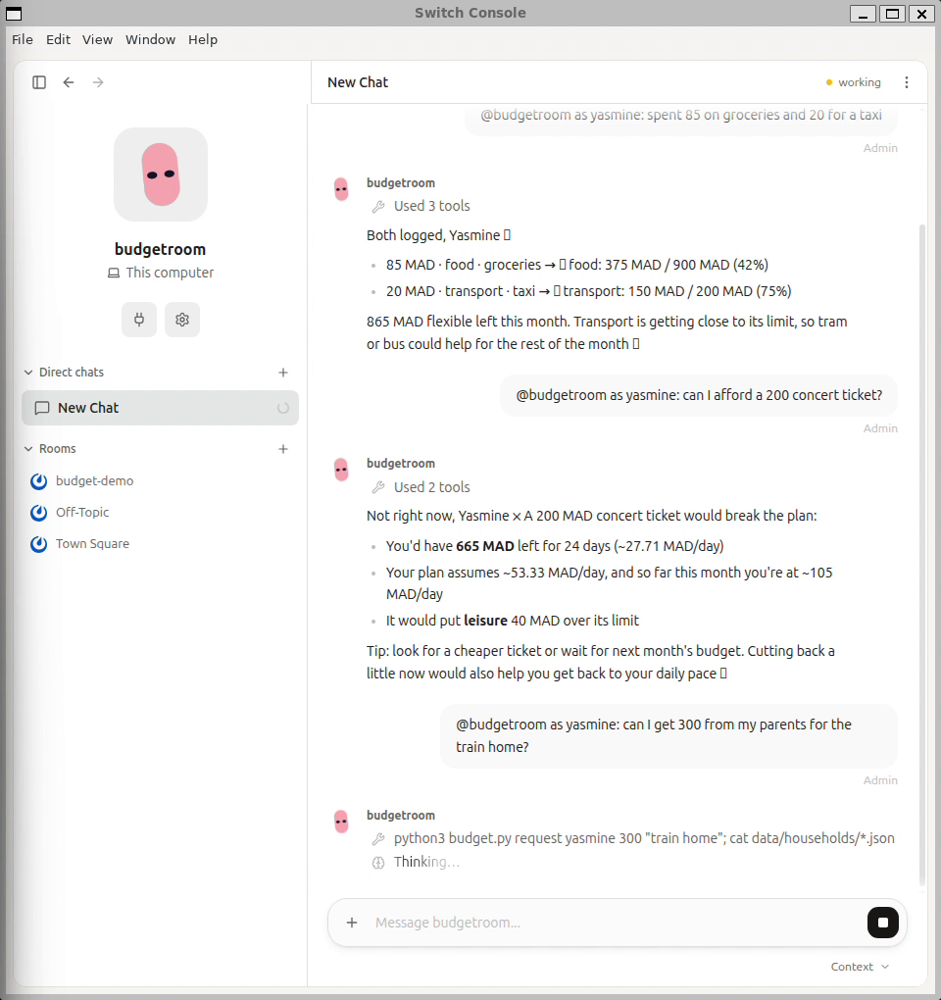

# BudgetRoom 💸

**A budgeting coach that lives in your chat rooms.** Students and parents text their
spending the way they'd text a friend; an AI agent running on
[Switch](https://www.wemakedevs.org/hackathons/switch) keeps the books, warns before
the money runs out, and answers "can I afford this?" with real numbers.

Built solo for the WeMakeDevs **Flip the Switch** hackathon (Track 2: Personal/Creative).

🎬 **Demo video:** VIDEO_LINK_HERE



Real replies from the demo (every number comes from `budget.py`):

```
Yasmine: spent 85 on groceries and 20 for a taxi
BudgetRoom: Got it, Yasmine, both logged ✅
            🟢 food: 375 MAD / 900 MAD (42%)
            🟡 transport: 150 MAD / 200 MAD (75%)
            865 MAD flexible left this month. Tram or bus could stretch the last 50 MAD 🚋
Yasmine: can I afford a 200 concert ticket?
BudgetRoom: ❌ Not right now. You'd have 665 MAD left for 24 days (~27.71 MAD/day)
            but your plan assumes ~53.33 MAD/day, and leisure would go 40 MAD over.
Yasmine: can I get 300 from my parents for the train home?
BudgetRoom: 📨 Request #1 sent. Karim: possible but tight, you'd have 2,230 MAD
            left for 24 days (~92.92 MAD/day vs ~123.33 planned).
Karim: approve 1
BudgetRoom: ✅ 300 MAD recorded from Karim to Yasmine. No real money has moved.
Léa: j'ai dépensé 12€ au resto
BudgetRoom: C'est noté, Léa ✅ 🟢 food : 82,90 € / 300 € · il te reste 449,10 €.
```

## Profiles in the demo

| Profile | Who | Currency |
|---|---|---|
| `yasmine` | Student in Rabat: scholarship + parents + tutoring | MAD |
| `karim` | Her father in Casablanca: salary, rent, school fees | MAD |
| `lea` | Student in Lyon working weekends in a café | EUR |
| `maria` | Single parent in Austin building an emergency fund | USD |

Yasmine and Karim form a **household**: Yasmine can request money with a reason, Karim
sees the impact on his own budget before approving, and both ledgers update.

## How it works

```
Mattermost room ──► Switch ──► Claude Code (reads CLAUDE.md)
                                   │  turns chat into commands
                                   ▼
                              budget.py  ──► data/profiles/*.json  (the plan)
                              (all math)     data/ledgers/*.csv    (every expense)
                                             data/households/*     (allowance requests)
```

- **The LLM never does arithmetic.** It parses messages and calls `budget.py`, which
  owns every number. Answers are deterministic and tested.
- **Files beat memory.** A Switch session keeps chat context across messages, so the
  agent is told (in `CLAUDE.md`) to re-run a command for every message and to trust only
  the files. We hit exactly this bug in testing: after a data reset the bot "remembered" an
  approval that no longer existed. The rule fixed it.
- **Coaching, not advice:** it refuses investment/crypto/loan questions and steers back
  to the person's own savings goal.
- **Plain files as state:** profiles are JSON, ledgers are CSV. You can open them in a
  spreadsheet, diff them in git, and nothing is hidden in a database.
- **Fixed costs** (rent, phone, school) are reserved up front; the agent coaches on the
  *flexible* part, which is where budgets actually break.
- Per-category pace alerts: 🟢 on track · 🟡 spending faster than the month passes ·
  🔴 over limit · ⚪ unplanned category.

## Run it

```bash
git clone <this repo> && cd switch-budget
./reset_demo.sh                       # copy seed/ data into data/
python3 -m unittest discover tests    # 7 tests, stdlib only
export BUDGET_TODAY=2026-11-05        # optional: freeze the demo date
python3 budget.py status yasmine
python3 budget.py afford yasmine 350 leisure --what "Concert ticket"
python3 budget.py request yasmine 300 "train to Casa"
python3 budget.py approve karim 1
pip install -r requirements.txt       # optional, for PNG charts
python3 budget.py report maria --png report.png
```

### With Switch

1. Install and start Switch (local server with Mattermost).
2. Create an agent whose working directory is this repo (so Claude Code picks up `CLAUDE.md`).
3. In the agent settings set **Who can talk to your agent → Anyone**; otherwise the
   bot stays silent (switch-core logs `sender not claimed by any Switch user`).
4. Invite it to rooms (`/invite @budgetroom`), e.g. `#yasmine-budget`, `#alaoui-family`.
5. Create Mattermost users matching `chat_users` in the profiles, or prefix messages
   with `as yasmine:` when demoing alone.
6. After `./reset_demo.sh`, start a fresh session (new room or "New session in this
   room") so the agent does not carry over chat context from before the reset.

## Not financial advice

BudgetRoom is a budgeting coach. It does not give investment, credit, loan or tax
advice, and it never moves real money: "approve" only records a transfer.
